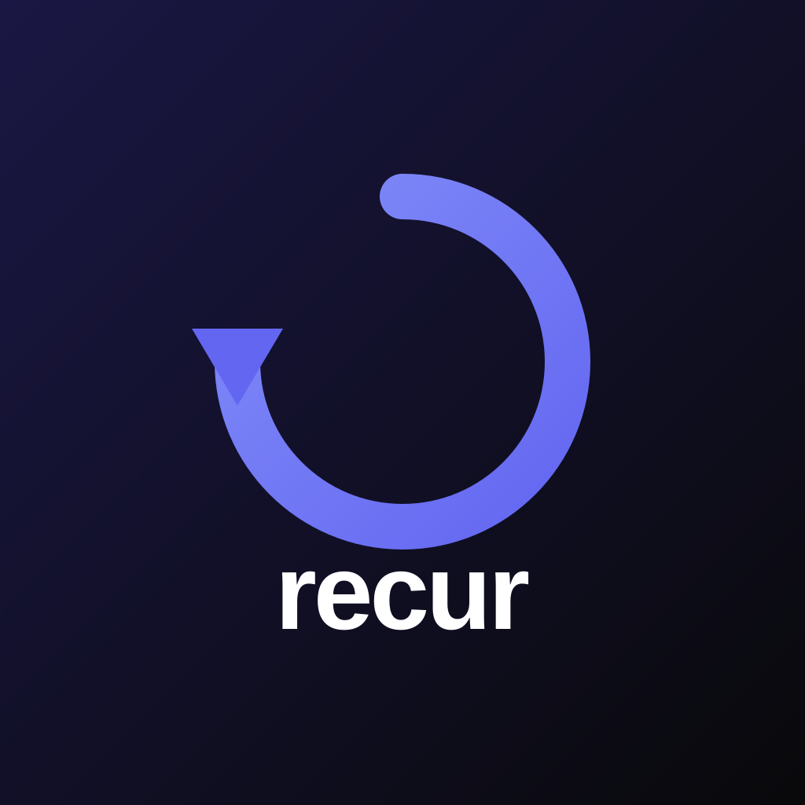
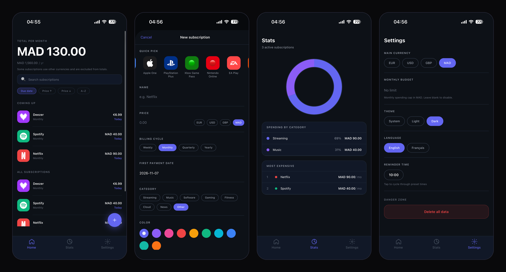
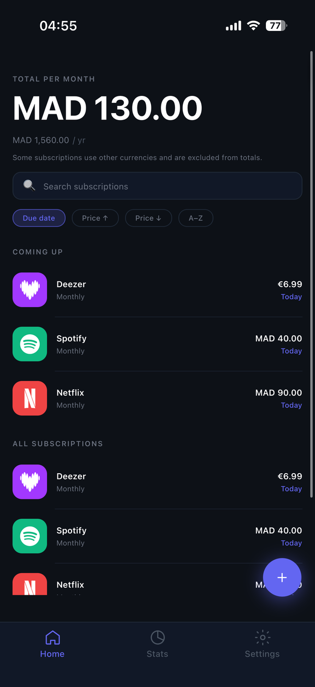
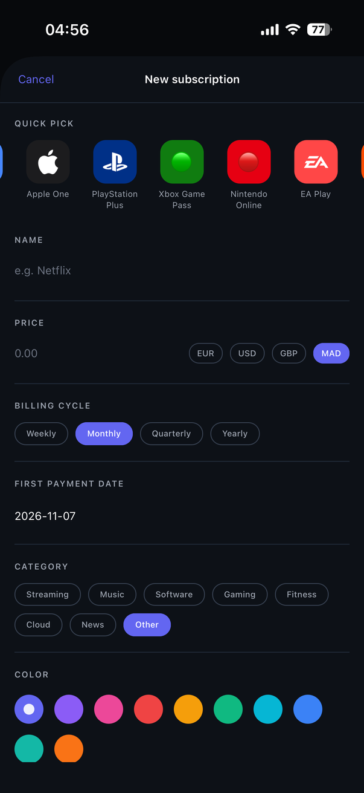
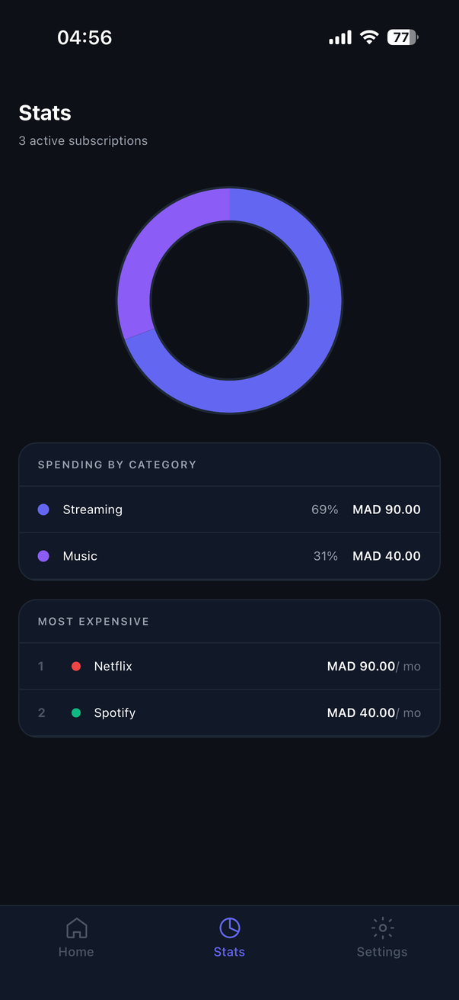
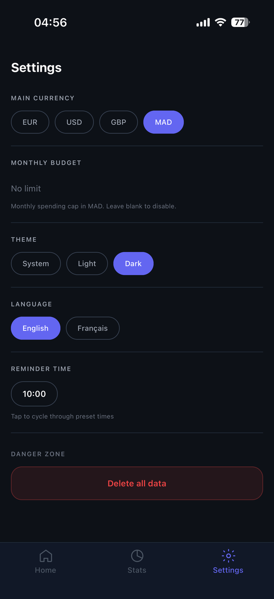

<div align="center">



# Recur

**A minimalist subscription tracker for iOS & Android.**
Know what you pay, when you pay it, and never get surprised by a renewal again.




</div>

---

## ✨ Features

- **All your subscriptions in one place**: name, price, billing cycle, category, color
- **Monthly & yearly totals** calculated automatically, whatever the billing cycle
- **Coming up**: see payments due in the next 7 days at a glance
- **Reminders**: local notification the day before each payment
- **Stats**: spending breakdown by category with an animated donut chart
- **Dark mode**, follows your system by default
- **French & English**
- **100% offline & private**: all data stays on your phone, no account, no server

## 📱 Screenshots

| Home | Add subscription | Stats | Settings |
|:---:|:---:|:---:|:---:|
|  |  |  |  |

## 🛠 Tech stack

| Layer | Technology |
|---|---|
| Framework | [Expo](https://expo.dev) + React Native |
| Language | TypeScript (strict) |
| Navigation | Expo Router (file-based) |
| Styling | NativeWind (Tailwind CSS) |
| Animations | Reanimated + Gesture Handler |
| Storage | expo-sqlite (local database) |
| State | Zustand |
| Notifications | expo-notifications |
| Charts | Custom SVG donut (react-native-svg) |
| i18n | i18next (FR / EN) |
| Tests | Jest |

## 🏗 Architecture

```
app/                 # Screens (Expo Router)
  (tabs)/            # Home, Stats, Settings
  subscription/      # Add / Details screens
src/
  components/        # Reusable UI components
  db/                # SQLite schema, migrations, queries
  store/             # Zustand stores
  lib/               # Pure business logic (dates, money, notifications)
  i18n/              # Translations
  theme/             # Design tokens (colors, spacing, typography)
__tests__/           # Unit tests for business logic
```

**A few design decisions:**
- **Prices are stored in cents** (integers) to avoid floating-point errors.
- **The next payment date is never stored.** It's computed from the first payment date and the billing cycle, so it's always correct.
- **Month-end edge cases are handled**: a subscription billed on Jan 31 renews on Feb 28/29.
- **Business logic lives in pure functions** (`src/lib`), separated from the UI and fully unit-tested.

## 🚀 Getting started

**Requirements:** Node.js (LTS) and the [Expo Go](https://expo.dev/go) app on your phone.

```bash
git clone https://github.com/Mosugar/recur.git
cd recur
npm install
npx expo start
```

Then scan the QR code with **Expo Go** (Android) or the **Camera app** (iOS).

### Run the tests

```bash
npm test
```

### Build an Android APK

```bash
npm install -g eas-cli
eas build -p android --profile preview
```

## 📥 Download

Android: grab the latest `.apk` from the [Releases](../../releases) page.

## 🗺 Roadmap

- [ ] Home screen widgets
- [ ] Export data (CSV)
- [ ] Cloud backup (iCloud / Google Drive)
- [ ] Multi-currency totals with exchange rates

## ⚖️ Disclaimer

Brand logos are trademarks of their respective owners and are used only to identify services.

## 👤 Author

**Mohamed Sekkar**, Full Stack Developer

- Portfolio: [mohamedsekkar.com](https://mohamedsekkar.com)
- LinkedIn: [linkedin.com/in/mohamedsekkar](https://linkedin.com/in/mohamedsekkar)
- Email: sekkarmohamedd@gmail.com

---

<div align="center">

Made with ☕ and React Native

</div>
